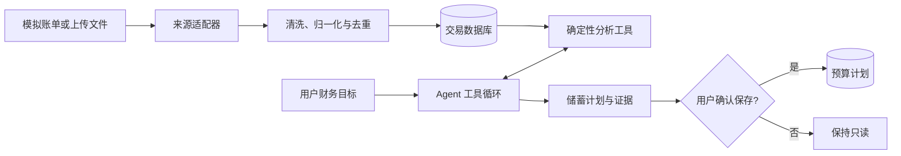

# FinSight Agent

一个面向 AI Agent / LLM 应用开发作品集的个人财务分析与储蓄规划项目。

FinSight Agent 读取可复现的模拟账单或用户导入的微信、支付宝账单，使用确定性工具完成金额计算，再由模型根据用户目标动态选择工具、连续调查并生成可执行的储蓄计划。

> 当前状态：里程碑 3 已完成。DeepSeek 已能围绕用户问题动态选择 8 个只读工具、连续调查并生成经预算模拟验证的回答；下一阶段是加入需要用户确认的预算写操作。

## 核心演示

用户提出目标：

> 我下个月想存下 2,000 元，请根据最近三个月的消费帮我制定计划。

系统应完成一条可观察的 Agent 链路：

1. 模型选择月度汇总工具，获取最近三个月的收入、支出和结余；
2. 根据结果决定是否继续查询分类明细、周期支出和异常交易；
3. 由工具计算储蓄缺口并模拟削减方案；
4. 模型解释一次性支出与长期趋势的区别，生成金额自洽的计划；
5. 系统展示工具调用轨迹；
6. 保存预算属于写操作，必须等待用户明确确认。

工具的选择和调用顺序由模型根据中间结果决定，而不是由代码预先固定。

## 项目价值

- 展示 Function Calling、连续工具调用和基于中间结果的动态决策；
- 展示结构化账单的清洗、字段统一、去重和 SQL 聚合；
- 使用确定性代码处理金额，避免模型直接计算财务数据；
- 使用 human-in-the-loop 保护分类修改和预算保存等写操作；
- 使用固定模拟数据和标准答案评测 Agent，而不依赖主观观感。

## 当前可运行能力

### M1：数据基础

- 使用固定种子 `42` 生成 2026-03 至 2026-08 的 357 条交易；
- 输出统一交易数据，以及微信、支付宝两种代表性 CSV；
- 将不同字段映射成统一 `TransactionInput`；
- 将金额统一存为分，避免浮点误差；
- 使用来源交易号或规范化哈希去重；
- 将退款计为支出冲减，将转账排除在收入和支出之外；
- 输出包含标准答案的 `demo_ground_truth.json`；
- 使用自动化测试验证可复现性、双来源导入和幂等性。

### M2：确定性分析工具

| 工具 | 作用 |
|---|---|
| `search_transactions` | 按日期、分类、商户、类型和金额查询脱敏交易摘要 |
| `get_monthly_summary` | 计算逐月收入、净支出、退款和结余 |
| `compare_periods` | 比较两个期间及各分类的支出变化 |
| `get_category_breakdown` | 汇总分类占比、固定/可变、周期和一次性支出 |
| `find_recurring_expenses` | 找出周期扣款，并仅将订阅标为可审查候选 |
| `find_abnormal_transactions` | 使用分类历史基线识别异常金额 |
| `calculate_saving_gap` | 计算历史平均结余与储蓄目标之间的缺口 |
| `simulate_budget` | 模拟分类预算，验证计划能否覆盖缺口 |

所有工具都使用 Pydantic 输入输出契约，可以脱离 Agent 独立调用。工具不会返回来源订单号、去重哈希或完整交易备注。

### M3：模型驱动的 Agent 工具循环

- DeepSeek Responses API 原生 function calling；
- 模型输出与工具结果组成无状态多轮上下文；
- 参数严格校验、连续重复调用保护、10 次调用上限、总超时和连续错误上限；
- `agent_runs` 与 `tool_calls` 保存模型、提示词版本及安全轨迹摘要；
- `ask-agent` 单问题入口与 `eval-agent` 固定 E01–E05 评测入口；
- 编排代码不包含针对具体问题的固定工具顺序。

## 数据来源

第一版支持两个入口：

- **体验演示**：加载固定随机种子生成的 6 个月、300～500 条模拟交易；
- **导入账单**：上传微信或支付宝导出的 CSV 文件，经各自适配器转换成统一交易模型。

模拟数据包含工资、房租、餐饮、交通、购物、订阅、退款、转账和异常消费，并预埋可验证的趋势与储蓄缺口。真实账单仅用于本地私下测试，不提交到版本库，也不写入应用日志。

## 初版技术方案

| 模块 | 选择 | 原因 |
|---|---|---|
| 后端 | Python + FastAPI | 接口清晰，便于测试和展示工具边界 |
| 数据访问 | SQLAlchemy | 统一 SQLite 与后续 PostgreSQL 的访问方式 |
| 数据库 | SQLite | 单人 MVP 零配置；需要部署时再迁移 PostgreSQL |
| 数据处理 | Python 标准库（M1） | 处理 CSV、清洗和生成演示数据；需要复杂分析时再引入 Pandas |
| Agent | DeepSeek Responses API Tool Calling（M3） | 使用 OpenAI 兼容接口展示模型驱动的多轮工具循环 |
| 界面 | Streamlit | 快速实现上传、图表、聊天、确认和调用轨迹 |
| 测试 | Pytest | 覆盖导入、计算、权限边界和评测场景 |

第一版不需要向量数据库、Redis、多 Agent 或自动抓取支付平台账户。LangGraph 仅在后续确实需要跨会话恢复复杂流程时再评估。

## 系统边界



## 文档导航

- [需求与范围](docs/requirements.md)
- [系统架构](docs/architecture.md)
- [数据模型](docs/data-model.md)
- [Agent 设计](docs/agent-design.md)
- [开发里程碑](docs/milestones.md)
- [执行计划](docs/execution-plan.md)
- [评测方案](docs/evaluation.md)

## 快速开始

需要 Python 3.12 和 [uv](https://docs.astral.sh/uv/)。在项目根目录执行：

```powershell
uv sync --all-groups
uv run python -m app.cli setup-demo --output data/demo --db data/runtime/finsight.db
```

复制环境变量模板并填写自己的 DeepSeek 密钥：

```powershell
Copy-Item .env.example .env
# 编辑 .env，只在本机填写 DEEPSEEK_API_KEY；.env 已被 Git 忽略。
```

`setup-demo` 会完成三件事：生成四个演示文件、创建 SQLite 表、依次导入微信和支付宝账单。再次执行同一命令时，两份导入报告的 `imported_rows` 都应为 `0`。

独立运行分析工具：

```powershell
uv run python -m app.cli run-tool calculate_saving_gap --arguments '{"target_amount_minor":200000,"lookback_months":3}'
uv run python -m app.cli run-tool find_abnormal_transactions --arguments '{"start_date":"2026-08-01","end_date":"2026-08-31"}'
uv run python -m app.cli tool-schema simulate_budget
```

运行 Agent 核心问题与固定评测：

```powershell
uv run python -m app.cli ask-agent "我下个月想存下2000元，请根据最近三个月的消费帮我制定计划。"
uv run python -m app.cli eval-agent
```

`ask-agent` 返回最终回答和工具级轨迹。`eval-agent` 检查 E01–E05 的必需工具、禁止工具、最少调用数和运行状态；它会产生真实 DeepSeek API 用量。

单独执行各步骤：

```powershell
uv run python -m app.cli generate-demo --output data/demo
uv run python -m app.cli init-db --db data/runtime/finsight.db
uv run python -m app.cli import-bill data/demo/demo_wechat_bill.csv --source wechat --db data/runtime/finsight.db
uv run python -m app.cli import-bill data/demo/demo_alipay_bill.csv --source alipay --db data/runtime/finsight.db
```

运行质量检查：

```powershell
uv run pytest
uv run ruff check .
```

## M1 验收结果

| 检查项 | 结果 |
|---|---:|
| 演示交易总数 | 357 |
| 微信 / 支付宝 | 201 / 156 |
| 退款 / 转账 / 一次性异常 | 2 / 12 / 1 |
| 首次导入新增 | 357 |
| 第二次导入新增 | 0 |
| 近三个月平均结余 | 1,071.81 元 |
| 距离 2,000 元目标的缺口 | 928.19 元 |
| Pytest | 3 passed |
| Ruff | All checks passed |

## M2 验收结果

| 检查项 | 结果 |
|---|---:|
| 独立分析工具 | 8 个 |
| 近三个月平均结余 | 1,071.81 元 |
| 2,000 元目标缺口 | 928.19 元 |
| 已识别周期商户 | 6 个 |
| 已识别预埋一次性异常 | 1500 元数码消费 |
| 覆盖测试 | 日期边界、退款、转账、一次性支出、空数据、非法参数 |
| 全部 Pytest | 11 passed |
| Ruff | All checks passed |

## M3 验收结果

| 检查项 | 结果 |
|---|---:|
| 核心储蓄问题 | completed |
| 核心工具路径 | 缺口 → 分类 → 周期支出 → 预算模拟 |
| 核心场景工具调用 | 4 次 |
| 模拟预计结余 | 2,000.81 元，达标 |
| 固定 Agent 评测 | E01–E05：5 / 5 passed |
| 动态路径 | 5 个问题产生 5 条不同工具序列 |
| 失败保护测试 | 参数错误、连续重复、调用上限 |
| 全部 Pytest | 18 passed |
| Ruff | All checks passed |

演示数据位于 `data/demo/`：

- `demo_transactions.csv`：统一模型；
- `demo_wechat_bill.csv`：代表性微信账单；
- `demo_alipay_bill.csv`：代表性支付宝账单；
- `demo_ground_truth.json`：后续分析工具和 Agent 评测的标准答案。

## 项目结构

```text
app/
  agent/         # DeepSeek 适配、多轮循环、轨迹与评测
  analytics/     # 8 个确定性工具、schema 和注册表
  demo/          # 固定数据生成器
  importers/     # 微信、支付宝适配器
  services/      # 幂等导入服务
  cli.py         # 数据导入与工具调试入口
data/demo/       # 可公开提交的合成数据
docs/            # 需求、架构、数据模型、Agent 与执行计划
tests/           # 数据、导入、分析工具和 Agent 循环测试
```

## 下一步

里程碑 4 将实现预算提议的待确认、确认、拒绝、过期和幂等保存。普通 Agent 循环仍只暴露只读工具；未经确认不会修改任何财务数据。

## 计划中的演示问题

- 我下个月想存下 2,000 元，请根据最近三个月的消费制定计划。
- 为什么我这个月的支出增加了？
- 我有哪些可以取消的周期性支出？
- 最近是否存在异常消费？
- 如果餐饮预算降低 20%，每月能多存多少钱？

## 项目定位说明

本项目提供消费数据分析与预算辅助，不提供投资、信贷、税务或法律建议。公开演示只使用合成数据。
