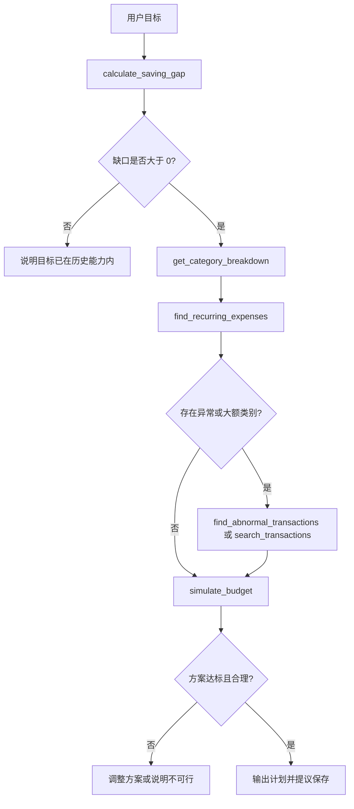

# Agent 设计

## 1. Agent 的定义

本项目中的 Agent 是一个由模型驱动的工具调用循环。用户只提供目标；模型根据可用工具、业务口径和已经返回的结果，决定下一步调用哪个工具、使用什么参数、是否需要继续查询，以及何时给出最终回答。

它与固定 workflow 的区别在于：应用没有预先编码唯一调用顺序。相同数据上的不同问题应产生不同路径；同一问题在某个工具返回异常结果时，模型可以进一步查询明细或调整参数。

## 2. 职责边界

| 参与者 | 负责 | 不负责 |
|---|---|---|
| 模型 | 理解目标、选工具、组合证据、解释与建议 | 自行计算大量金额、直接访问数据库、绕过确认 |
| 工具 | 校验参数、SQL 查询、精确计算、结构化返回 | 决定用户最终意图、撰写完整建议 |
| 编排层 | 执行循环、权限控制、超时、轨迹和错误处理 | 固定业务分析顺序 |
| 用户 | 确认会改变数据的操作 | 手工指定每个分析步骤 |

## 3. 运行循环

```text
接收用户目标
  -> 将只读工具 schema 提供给模型
  -> 模型返回工具调用或最终回答
  -> 服务端校验并执行工具
  -> 将结构化结果交还模型
  -> 模型根据新证据继续调用或结束
  -> 若出现写操作意图，生成待确认动作并暂停
```

安全限制：

- 单次运行最多 10 次工具调用；
- 同一工具和相同参数连续重复时阻止循环；
- 每次参数都通过 schema 和用户数据边界校验；
- 工具只返回完成任务所需的聚合结果或有限明细；
- 达到超时、调用上限或连续错误上限时生成可解释的失败结果；
- 不向界面暴露隐藏思维链，只展示工具级轨迹。

## 4. 第一版工具目录

### 只读工具

#### `search_transactions`

用途：在日期、分类、商户、类型和金额范围内查找有限数量的交易明细。

关键参数：`start_date`、`end_date`、`categories`、`merchant_query`、`transaction_types`、`min_amount_minor`、`max_amount_minor`、`limit`。

关键返回：匹配数、有限交易摘要、总金额、是否截断、统计口径。

限制：默认最多返回 20 条，不返回平台原始订单号或完整敏感备注。

#### `get_monthly_summary`

用途：计算指定月份范围内的收入、净支出和结余。

关键参数：`start_month`、`end_month`、`exclude_transfers=true`、`refund_mode=net`。

关键返回：逐月汇总、期间平均值、使用的月份数和口径。

#### `compare_periods`

用途：比较两个期间的总额和分类变化。

关键参数：两个闭区间、可选分类、是否排除一次性支出。

关键返回：绝对变化、变化率、主要贡献分类和口径。

#### `get_category_breakdown`

用途：按分类汇总消费，并区分固定、可变、周期性和一次性金额。

关键参数：日期范围、前 N 类、是否包含一次性支出。

关键返回：分类金额、占比、交易数和支出性质。

#### `find_recurring_expenses`

用途：识别周期性商户或订阅。

关键参数：回看月数、最少出现次数、日期和金额容差。

关键返回：商户、估计周期、典型金额、最近日期、置信度和可取消性标签。

“可取消性”只能作为候选标签，不能代表系统知道用户是否仍需要该服务。

#### `find_abnormal_transactions`

用途：找出相对个人历史或分类分布异常的交易。

关键参数：日期范围、分类、阈值策略、最大结果数。

关键返回：交易摘要、异常分数、基线和触发原因。

异常不等于错误或浪费，最终解释必须保留这一点。

#### `calculate_saving_gap`

用途：根据历史基线和目标储蓄额计算缺口。

关键参数：`target_amount_minor`、`lookback_months`、是否排除一次性支出。

关键返回：平均收入、平均支出、平均结余、目标额、缺口和数据充分性。

#### `simulate_budget`

用途：在不写数据库的情况下验证预算方案。

关键参数：目标月份、分类预算或削减项、收入假设。

关键返回：预计总支出、预计结余、目标是否达成、各项削减合计和警告。

### 面试版写工具

#### `create_budget_plan`

保存已模拟并展示给用户的预算计划。执行需要有效确认动作，payload 必须与用户确认内容完全一致。

写工具只在确认执行阶段由服务端调用，不作为普通 Agent 循环中可直接执行的工具。`update_transaction_category` 和商户规则在核心演示完成后再加入，避免它们阻塞储蓄规划链路。

## 5. 核心场景的可能路径

用户问题：

> 我下个月想存下 2,000 元，请根据最近三个月的消费帮我制定计划。

一条合理但不强制的路径是：



这张图描述可能的推理空间，不应被实现成固定条件流水线。实际调用由模型决定，评测只检查证据充分性、工具合法性和结果正确性。

## 6. 提示词契约

系统提示词只规定稳定边界：

- 使用工具获取事实，不编造交易、金额或工具结果；
- 金额计算交给工具；
- 在回答中标明分析时间范围和关键口径；
- 数据不足时说明不足并请求必要信息；
- 将一次性支出与可持续削减分开；
- 在给出计划前用 `simulate_budget` 验证金额；
- 不把消费分析包装成投资或信贷建议；
- 写操作只能形成提议，不能宣称已经保存；
- 用户确认后由应用执行写入。

业务规则和计算公式放在代码与工具中，而不是依赖长提示词维持。

## 7. 确认机制

### 创建预算

1. Agent 调用 `simulate_budget`；
2. 应用把规范化方案保存为 `pending_action`；
3. 界面展示基线、目标、各分类变更、预计结余和有效期；
4. 用户点击确认或输入明确确认；
5. 服务端校验用户、动作类型、payload 哈希、状态和过期时间；
6. 服务端调用 `create_budget_plan`；
7. 动作标记为已执行并返回预算 ID。

如果用户要求修改方案，旧动作作废，必须针对新内容重新确认。

### 修改分类（后续能力）

确认界面同时区分：

- 只修改当前交易；
- 修改当前交易，并为相同商户创建后续分类规则。

两个动作的影响范围不同，不能使用同一个含糊确认按钮。

## 8. 轨迹展示

每一步展示：

- 顺序号和工具名称；
- 参数摘要，例如“最近 3 个完整月份”；
- 成功、失败或重试状态；
- 耗时；
- 结果摘要，例如“平均结余 1,150 元，目标缺口 850 元”；
- 该结果采用的口径。

不展示：模型隐藏思维链、完整原始交易、密钥、原始订单号和未脱敏备注。

## 9. 状态与记忆

第一版只实现有明确业务价值的持久状态：

- 用户的商户分类规则；
- 储蓄目标和已确认预算；
- 待确认动作；
- Agent 运行与工具调用轨迹。

不实现泛化的长期对话记忆或向量记忆。当前会话上下文用于语言连续性，财务事实每次从工具读取。
