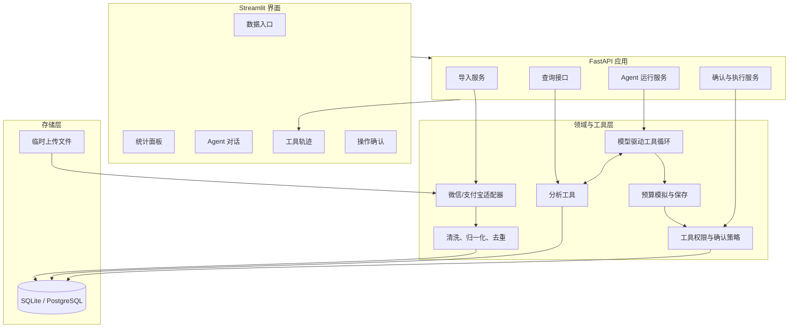
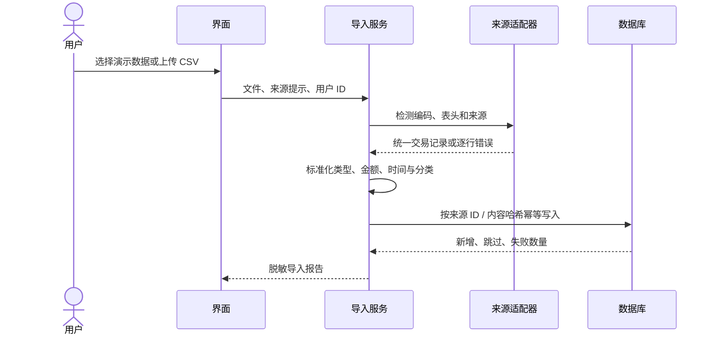
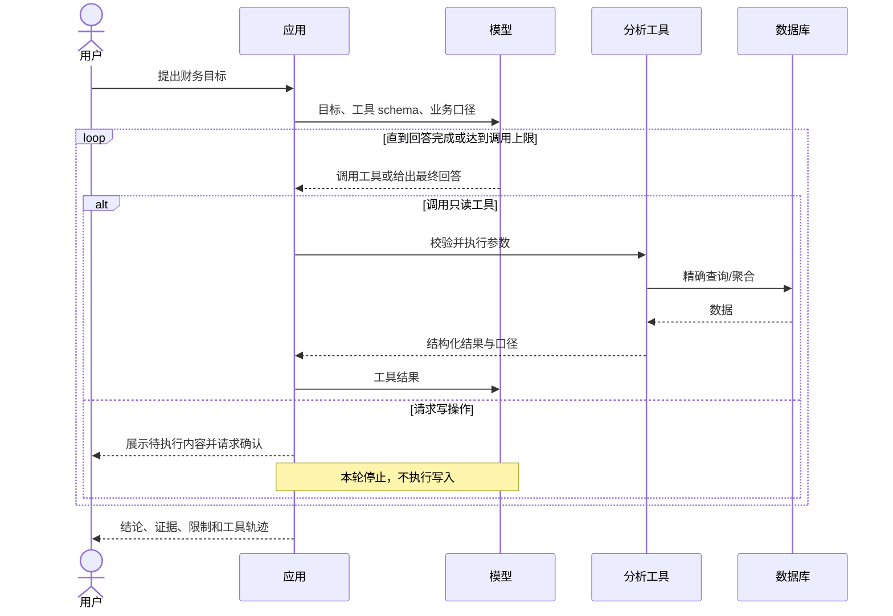

# 系统架构

## 1. 设计原则

1. 模型负责理解目标、选择工具、决定是否继续查询和解释结果；
2. SQL 与确定性代码负责筛选、聚合、金额计算和写入；
3. 用户负责确认会改变数据的操作；
4. 模块边界围绕业务责任划分，第一版保持单体应用；
5. 工具轨迹可观察，但不记录模型私有推理过程。

## 2. 逻辑组件



## 3. 建议目录结构

```text
finsight-agent/
├─ app/
│  ├─ api/                 # FastAPI 路由和请求/响应 schema
│  ├─ agent/               # 提示词、工具注册、运行循环、权限策略
│  ├─ analytics/           # 确定性分析函数
│  ├─ importers/           # 微信/支付宝适配器与归一化
│  ├─ models/              # SQLAlchemy 领域模型
│  ├─ repositories/        # 数据访问与查询
│  ├─ services/            # 导入、预算、确认等用例服务
│  ├─ config.py
│  └─ main.py
├─ ui/                     # Streamlit 页面与组件
├─ scripts/                # 演示数据生成和初始化脚本
├─ tests/
│  ├─ unit/
│  ├─ integration/
│  └─ evals/
├─ data/
│  └─ demo/                # 可公开的固定模拟 CSV
├─ docs/
├─ .env.example
├─ pyproject.toml
└─ README.md
```

目录结构属于实现阶段的目标形态，里程碑 1 再创建业务目录。

## 4. 数据导入流程



上传文件只在处理期间保存在受控临时目录；原始文件不进入 Git，也不应被长期保留。

## 5. Agent 运行流程



这个循环没有预设“先调用 A，再调用 B”。应用只负责执行模型选择的合法工具、返回结果、限制循环和拦截写操作。

## 6. 写操作确认流程

写操作采用两阶段协议：

1. **提议阶段**：Agent 使用 `simulate_budget` 或形成分类修改提议，应用将规范化后的 payload 保存到 `pending_actions`；
2. **确认阶段**：用户查看完整变更并明确确认，服务端校验用户、内容哈希、状态和过期时间；
3. **执行阶段**：服务端短暂开放对应写能力并执行一次；
4. **终态**：动作变为 `executed`、`rejected` 或 `expired`，同一令牌不能重复使用。

写工具不会在普通只读 Agent 工具集合中无条件暴露。确认是服务端权限条件，不只依赖提示词约束。

## 7. 部署形态

MVP 使用单仓库、单后端、单数据库：

```text
Browser -> Streamlit -> FastAPI -> SQLite
                           |
                           -> DeepSeek Responses API
```

本地开发优先 SQLite。需要公开部署时可将数据库切换到 PostgreSQL，应用层不改变领域接口。第一版不拆微服务。

## 8. 关键失败处理

- 文件格式错误：返回可修正的字段/行错误，不进行部分静默导入；
- 重复上传：报告跳过条数，保持幂等；
- 工具参数错误：返回结构化错误供模型修正一次；
- 模型持续无效调用：达到上限后停止并说明无法完成；
- 模型不可用：统计和导入功能仍可使用；
- 写入确认过期或不匹配：拒绝执行并要求重新生成提议；
- 数据不足：明确缺少的月份或字段，不生成虚假精确结论。

## 9. 可替换点

- SQLite 可替换为 PostgreSQL；
- Streamlit 可替换为 React/Next.js；
- 模型供应商封装在 Agent 适配层；
- 如果未来确实需要长时间暂停和跨会话恢复，可将当前循环迁移到 LangGraph checkpoint，不改变工具契约。
