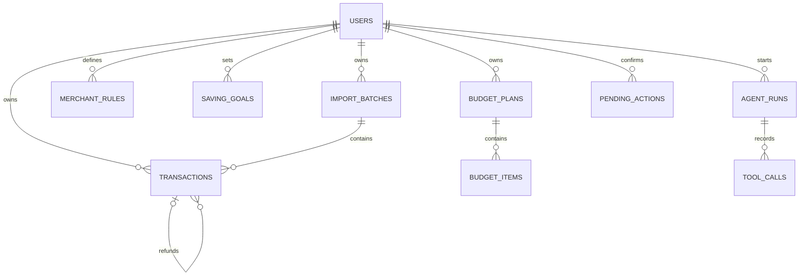

# 数据模型

## 1. 建模约定

- 主键使用 UUID 字符串；
- 金额使用整数分 `amount_minor` 存储，币种第一版固定为 `CNY`；
- 时间存储为带时区时间，展示时转换为用户时区；
- 原始敏感字段尽量不持久化，必要字段经过归一化或哈希；
- 第一版只有演示用户，但所有业务表保留 `user_id` 以避免后续重构；
- 枚举在应用层和数据库约束中保持一致。

## 2. 实体关系

## 3. 核心表

### users

| 字段 | 类型 | 说明 |
|---|---|---|
| id | string/UUID | 主键；演示环境使用固定用户 |
| display_name | string | 展示名称 |
| timezone | string | 默认 `Asia/Shanghai` |
| created_at | datetime | 创建时间 |

第一版不实现完整登录系统，`users` 仅用于数据隔离和接口设计。

### import_batches

| 字段 | 类型 | 说明 |
|---|---|---|
| id | UUID | 导入批次 |
| user_id | UUID | 所属用户 |
| source | enum | M1 为 `wechat`、`alipay` |
| file_fingerprint | string | 文件内容哈希，用于识别重复上传 |
| original_filename | string | 只保存文件名，不保存本地路径 |
| status | enum | `processing`、`completed`、`partial`、`failed` |
| total_rows | integer | 原始数据行数 |
| imported_rows | integer | 新增行数 |
| duplicate_rows | integer | 重复行数 |
| ignored_rows | integer | 忽略行数 |
| failed_rows | integer | 无法解析行数 |
| created_at | datetime | 开始时间 |
| completed_at | datetime nullable | 完成时间 |

约束：同一用户、同一来源的 `file_fingerprint` 唯一。解析问题通过导入报告返回；M1 不持久化原始错误文本。

### transactions

| 字段 | 类型 | 说明 |
|---|---|---|
| id | UUID | 统一交易 ID |
| user_id | UUID | 所属用户 |
| import_batch_id | UUID | 来源批次 |
| source | enum | `wechat`、`alipay` |
| source_transaction_id | string nullable | 平台订单号的安全形式 |
| occurred_at | datetime | 交易时间 |
| direction | enum | `income`、`expense`、`neutral` |
| transaction_type | enum | `expense`、`income`、`refund`、`transfer` |
| amount_minor | integer | 非负金额，单位分 |
| currency | string | 第一版固定 `CNY` |
| merchant_normalized | string | 归一化商户名 |
| description_safe | string nullable | 脱敏后的简短描述 |
| category | enum/string | 工资、住房、餐饮、交通、购物、订阅等 |
| expense_nature | enum | `fixed`、`variable`、`non_expense` |
| is_recurring | boolean | 是否识别为周期支出 |
| is_one_off | boolean | 是否识别为一次性支出 |
| related_transaction_id | string nullable | 退款对应的来源交易号；后续需要写操作时再升级为统一交易外键 |
| dedup_key | string | 规范化记录哈希 |
| created_at | datetime | 入库时间 |

`category_source`、`category_confidence` 和 `updated_at` 在分类修改里程碑再加入，避免 M1 提前实现未使用状态。

关键约束：

- `amount_minor >= 0`；
- `(user_id, source, source_transaction_id)` 在订单号存在时唯一；
- `(user_id, dedup_key)` 唯一，覆盖没有可靠订单号的来源；
- 退款通过 `transaction_type=refund` 表示，不将金额存成负数；
- `neutral` 方向的转账默认不进入收支统计。

建议索引：

- `(user_id, occurred_at)`；
- `(user_id, category, occurred_at)`；
- `(user_id, merchant_normalized)`；
- `(user_id, transaction_type, occurred_at)`。

### merchant_rules

| 字段 | 类型 | 说明 |
|---|---|---|
| id | UUID | 规则 ID |
| user_id | UUID | 所属用户 |
| match_type | enum | `exact`、`contains`、`regex` |
| pattern | string | 归一化后的匹配内容 |
| category | string | 目标分类 |
| priority | integer | 冲突时优先级 |
| enabled | boolean | 是否启用 |
| created_from_transaction_id | UUID nullable | 由哪次纠错产生 |
| created_at | datetime | 创建时间 |

分类优先级：用户规则 > 内置商户规则 > LLM 兜底 > 未分类。

### saving_goals

| 字段 | 类型 | 说明 |
|---|---|---|
| id | UUID | 目标 ID |
| user_id | UUID | 所属用户 |
| target_month | date | 目标月份，按月首日保存 |
| target_amount_minor | integer | 目标储蓄金额 |
| status | enum | `active`、`achieved`、`cancelled` |
| created_at | datetime | 创建时间 |

### budget_plans

| 字段 | 类型 | 说明 |
|---|---|---|
| id | UUID | 预算计划 ID |
| user_id | UUID | 所属用户 |
| saving_goal_id | UUID nullable | 对应储蓄目标 |
| target_month | date | 生效月份 |
| baseline_income_minor | integer | 基线月收入 |
| baseline_expense_minor | integer | 基线月支出 |
| baseline_balance_minor | integer | 基线月结余 |
| target_saving_minor | integer | 目标结余 |
| required_reduction_minor | integer | 需要改善的缺口 |
| projected_balance_minor | integer | 方案预计结余 |
| status | enum | `active`、`superseded`、`cancelled` |
| source_agent_run_id | UUID nullable | 生成它的 Agent 运行 |
| created_at | datetime | 确认写入时间 |

### budget_items

| 字段 | 类型 | 说明 |
|---|---|---|
| id | UUID | 条目 ID |
| budget_plan_id | UUID | 所属计划 |
| category | string | 分类 |
| baseline_minor | integer | 历史基线 |
| target_minor | integer | 建议预算 |
| reduction_minor | integer | 预计减少金额 |
| rationale | string | 基于工具事实的简短理由 |

约束：`reduction_minor = max(baseline_minor - target_minor, 0)`；所有条目减少金额之和应与计划预计改善额一致。

### pending_actions

| 字段 | 类型 | 说明 |
|---|---|---|
| id | UUID | 待确认动作 ID |
| user_id | UUID | 所属用户 |
| agent_run_id | UUID | 来源运行 |
| action_type | enum | `create_budget_plan`、`update_category`、`create_merchant_rule` |
| payload | JSON | 规范化待执行内容 |
| payload_hash | string | 防止确认后内容被替换 |
| status | enum | `pending`、`executed`、`rejected`、`expired` |
| expires_at | datetime | 过期时间 |
| confirmed_at | datetime nullable | 用户确认时间 |
| executed_at | datetime nullable | 实际写入时间 |

约束：只有 `pending` 且未过期、用户匹配、哈希匹配的动作可以执行；执行后状态不可回退。

## 4. Agent 可观察性表

### agent_runs

| 字段 | 类型 | 说明 |
|---|---|---|
| id | UUID | 运行 ID |
| user_id | UUID | 所属用户 |
| user_request_safe | string | 脱敏后的问题 |
| status | enum | `running`、`completed`、`awaiting_confirmation`、`failed` |
| model | string | 实际模型标识 |
| started_at | datetime | 开始时间 |
| completed_at | datetime nullable | 结束时间 |
| final_response_safe | text nullable | 可选的脱敏答案 |
| error_code | string nullable | 稳定错误码 |

### tool_calls

| 字段 | 类型 | 说明 |
|---|---|---|
| id | UUID | 调用 ID |
| agent_run_id | UUID | 所属运行 |
| sequence_no | integer | 调用顺序 |
| tool_name | string | 工具名称 |
| arguments_safe | JSON | 验证并脱敏后的参数 |
| result_summary | JSON | 精简结果与统计口径 |
| status | enum | `started`、`succeeded`、`failed` |
| duration_ms | integer | 执行耗时 |
| created_at | datetime | 调用时间 |

只记录工具级行为，不保存模型的隐藏思维链。

## 5. 演示数据事实表

生成器必须同时输出机器可读的 `demo_ground_truth.json`，至少包含：

- 数据覆盖日期和交易数；
- 各月收入、净支出和结余；
- 最近三个月平均结余；
- 给定 2,000 元目标时的储蓄缺口；
- 已知周期支出；
- 已知一次性大额支出；
- 已知趋势变化；
- 退款和转账的预期统计处理方式。

评测读取这份事实表，不在测试中复制一套容易漂移的魔法数字。
